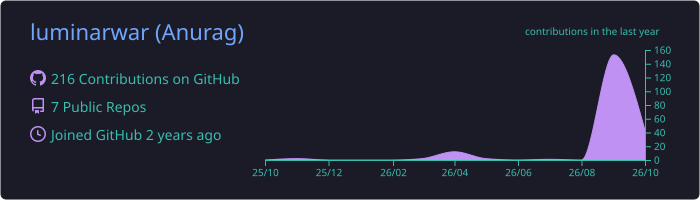
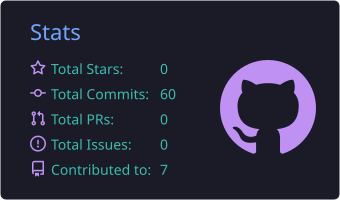
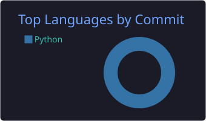

<!-- ───────────── Header (switches with GitHub light/dark theme) ───────────── -->
<picture>
  <source media="(prefers-color-scheme: dark)" srcset="https://capsule-render.vercel.app/api?type=rect&height=170&color=0:0d1117,60:2a2470,100:6C63FF&text=Anurag%20Kumar&fontColor=ffffff&fontSize=48&fontAlignY=42&desc=AI%20Engineering%20%E2%86%92%20Embodied%20AI&descAlignY=68&descSize=17" />
  
</picture>

---

### 👋 Hi, I'm Anurag

I'm learning to build and ship real **AI applications** — and doing it in public. My days go into LLMs, prompting, RAG, agents, evals and fine-tuning, with every phase ending in a project that lands on this profile.

So far that's produced agents that query databases in plain English, a RAG pipeline that can read scanned documents, and a team of LLM agents that research a topic together. I also keep a daily AI news briefing so I know where the field is heading, not just where it's been.

Once the AI foundations are solid, I'm taking those agents off the screen and into the physical world through a long-term course in **robotics and embodied AI**.

<table>
<tr>
<td width="33%" valign="top">

**🧠 Learning (AI)** 
How LLMs work, LLM APIs & tool use, RAG, agents & MCP, evals, open models & fine-tuning

</td>
<td width="33%" valign="top">

**🔨 Building** 
Agentic apps, RAG + OCR document search, multi-agent research tools

</td>
<td width="33%" valign="top">

**🤖 Exploring next** 
Robotics math, kinematics & Jacobians, control, ROS 2, robot learning

</td>
</tr>
</table>

---

### 🧭 My AI learning path

→

→

→

→

 
→

→

→

→

Full roadmap, notes, practice notebooks and daily briefings live in <a href="https://github.com/luminarwar/PlayGround">PlayGround</a>.

---

### 🧪 Featured AI work

<table>
<tr>
<td width="50%" valign="top">

#### 🧭 [PlayGround](https://github.com/luminarwar/PlayGround)
**My AI learning workspace.** A living roadmap from LLM internals to shipping, topic-by-topic notes and notebooks, portfolio projects, and `/newsbooth` — a daily briefing on AI, startups and jobs.

  

</td>
<td width="50%" valign="top">

#### 📄 [DocMe](https://github.com/luminarwar/DocMe---RAG-agent-with-ocr)
**RAG agent with OCR.** Ask questions of scanned and image-based documents in plain language — OCR extracts the text, retrieval grounds the answers.

  

</td>
</tr>
<tr>
<td width="50%" valign="top">

#### 🔬 [RSRCH](https://github.com/luminarwar/RSRCH---Multi-Agent-Research-Assistant)
**Multi-agent research assistant.** Specialized agents split up a research question, gather findings, and compile them into one report.

  

</td>
<td width="50%" valign="top">

#### 🤖 [GEN-AI-Projects](https://github.com/luminarwar/GEN-AI-Projects)
**A lab notebook of GenAI builds** — Q&A bot, Google-powered agent, Groq chatbot, natural-language SQL agent, and a RAG agent.

   

</td>
</tr>
</table>

---

### 🦾 Also exploring: robotics & embodied AI

**[JACKOBIAN](https://github.com/luminarwar/JACKOBIAN)** — a long-term, self-directed course that extends my AI work into robots: math for robotics → kinematics & Jacobians → control & MuJoCo → a first real ESP32 robot → perception & SLAM → ROS 2 → robot learning (RL, imitation learning, VLAs). One lesson per day, with exercises and end-of-phase builds.

---

### 🧰 Toolbox

| | |
|---|---|
| **Core** |      |
| **LLMs & GenAI** |      |
| **AI — learning now** |      |
| **Apps & workflow** |      |
| **Robotics — next** |     |

---

### 📈 Activity

<!-- Generated in this repo by .github/workflows/profile-summary-cards.yml -->

---

Learning AI every day, building robots next. Thanks for stopping by — say hi on <a href="https://www.linkedin.com/in/anurag-kumar-3916a9209/">LinkedIn</a>.

